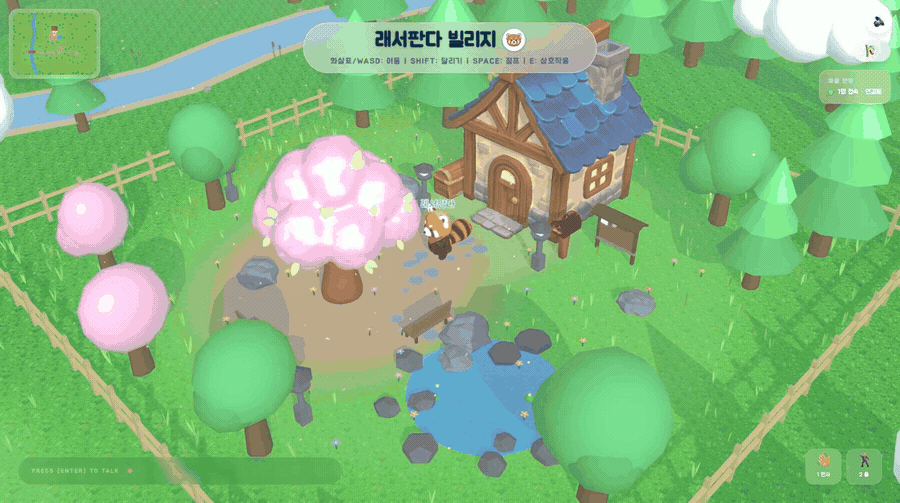

# 래서판다 빌리지

- 닉네임을 정하고 마을을 산책하는 3D 웹 프로젝트
- 방문자가 남긴 쪽지와 실시간 채팅으로 소통

[마을 둘러보기](https://lessor-panda-village.vercel.app)

  
  

## 주요 기능

- 걷기·달리기·점프·벤치 앉기
- 인사·춤·죽순 수확
- 방명록·실시간 채팅
- 그래픽 품질 자동·수동 조절
- 서버 연결이 끊겨도 불러온 마을 산책

## 제작

- 체험·화면 기획, 프론트엔드 구성과 인터랙션 작업
- AI 코딩 도구로 구현·수정, 생성형 3D 에셋 사용
- 월드 배치 데이터를 렌더링·충돌·미니맵에서 공유
- 쪽지는 DB에 저장하고 캐릭터 움직임은 실시간 전달
- 모델 변환 스크립트와 원격 캐릭터의 거리별 LOD 적용

## 기술

Next.js · React · TypeScript · React Three Fiber · Three.js · Zustand · Supabase · Tailwind CSS

## 참고

- P400의 1080p·30fps와 실서버 3~4인 동시 접속은 실측 성능을 보장하지 않음
- [설계와 성능 확인 항목](docs/architecture.md)
