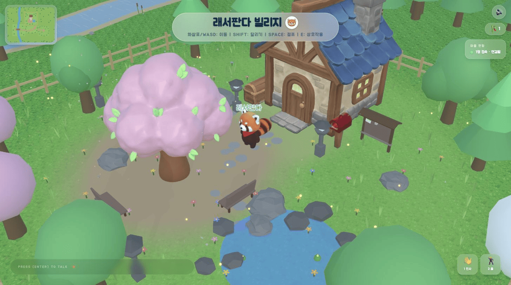
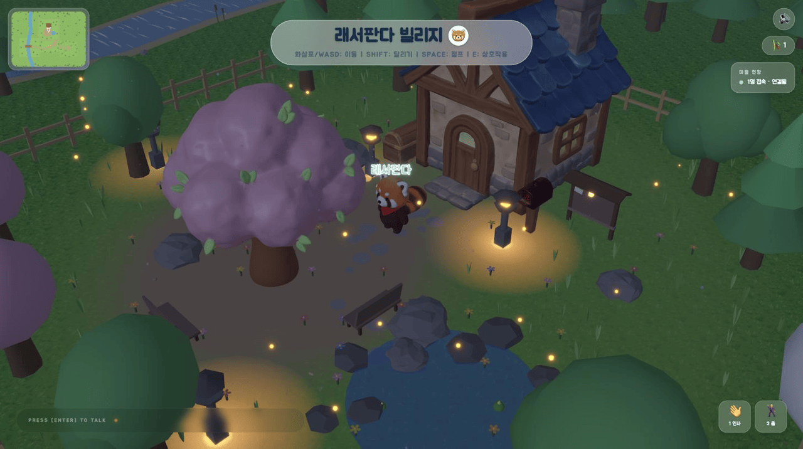

# 래서판다 빌리지

닉네임을 정해 3D 마을을 산책하고, 다른 방문자와 쪽지 및 실시간 채팅으로 소통할 수 있는 웹 프로젝트입니다.

[마을 둘러보기](https://lessor-panda-village.vercel.app)



<p align="center">
  
  
</p>

## 주요 기능

- 걷기, 달리기, 점프, 벤치 앉기
- 인사, 춤, 죽순 수확
- 방명록 및 실시간 채팅
- 그래픽 품질 자동 및 수동 조절
- 서버 연결이 끊겨도 불러온 마을 산책 가능

## 기술 스택

Next.js, React, TypeScript, React Three Fiber, Three.js, Zustand, Supabase, Tailwind CSS

## 실행

```sh
pnpm install
pnpm dev
```

- Node.js 22 이상 환경이 필요합니다.
- 채팅과 쪽지 기능을 쓰려면 `.env.local`에 `NEXT_PUBLIC_SUPABASE_URL`, `NEXT_PUBLIC_SUPABASE_ANON_KEY`를 설정하고 Supabase 익명 로그인을 활성화해야 합니다. 환경 변수 없이도 마을 화면 자체는 실행할 수 있습니다.
- DB 변경 사항은 `supabase/migrations`에 추가해 클라이언트보다 먼저 적용합니다.

## 개발 명령

- `pnpm lint`: 린트 검사
- `pnpm test:client`: 클라이언트 테스트
- `pnpm test:world-db`: 격리 DB에서 권한 검사
- `pnpm build`: 프로덕션 빌드
- `pnpm world:verify`: 통합 검증 (테스트 환경 전용)

[코드 구조와 에셋 처리](docs/architecture.md)
